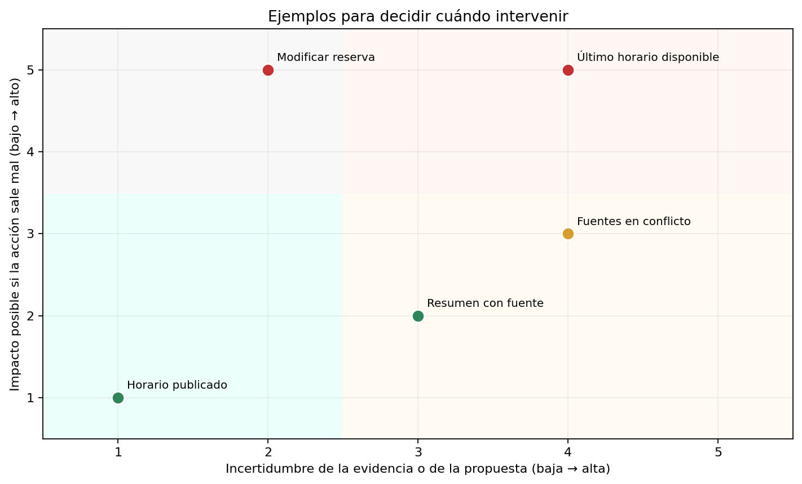
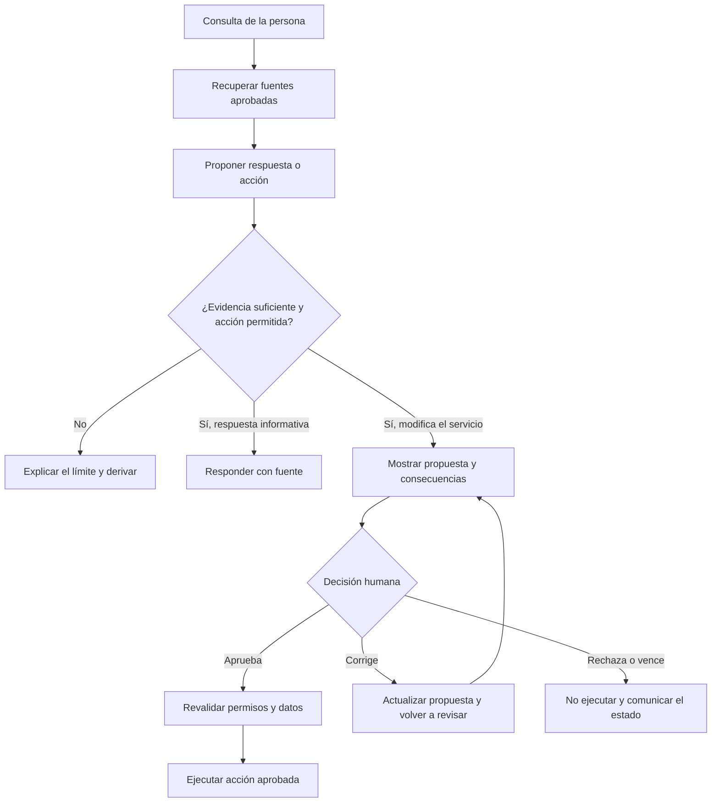
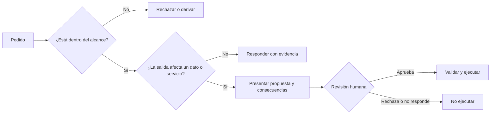

# Clase 9 — Human-in-the-Loop: supervisión humana de sistemas de IA

**Duración:** 120 minutos  
**Modalidad:** explicación guiada, demostración y trabajo grupal  
**Producto:** política de revisión humana y diagrama de un flujo supervisado

## Pregunta central

**¿Cuándo una recomendación de IA puede seguir su camino y cuándo debe detenerse para que una persona revise o decida?**

## Objetivos de aprendizaje

Al finalizar, vas a poder:

- explicar qué significa Human-in-the-Loop (HITL) y qué objetivo cumple;
- distinguir entre mostrar una respuesta, derivar una consulta y solicitar aprobación antes de actuar;
- definir condiciones observables para solicitar revisión humana;
- diseñar una solicitud de revisión que presente evidencia, propuesta y consecuencias;
- especificar qué hará el sistema ante una aprobación, un rechazo, una corrección o la falta de respuesta;
- relacionar la supervisión con permisos, registro de decisiones y gestión de riesgos.

## Idea central

Un sistema de IA puede analizar información y proponer una respuesta o acción. La organización define qué puede continuar automáticamente, qué debe derivarse y qué debe esperar una aprobación. Para que la intervención tenga sentido, la persona revisora necesita autoridad para decidir, información suficiente y tiempo para evaluar la propuesta.

HITL no es una casilla de “aprobar” que se marca sin leer. Tampoco implica que alguien revise cada salida. El nivel de intervención depende del impacto posible, la incertidumbre, las reglas del servicio y la posibilidad de corregir o revertir el resultado.

La responsabilidad se reparte entre personas, aplicación y modelo. Una revisión humana no reemplaza los permisos, las validaciones ni los controles técnicos de la aplicación.

## Agenda

| Tiempo | Momento | Propósito |
|---:|---|---|
| 0–10 min | Apertura | Identificar decisiones que necesitan intervención |
| 10–30 min | Concepto HITL | Separar respuesta, derivación y aprobación |
| 30–50 min | Riesgo y criterios | Definir señales que activan una revisión |
| 50–65 min | Demostración docente | Recorrer una propuesta hasta su resolución |
| 65–105 min | Trabajo grupal | Diseñar una política HITL para un servicio |
| 105–112 min | Puesta en común | Contrastar decisiones y controles |
| 112–120 min | Cierre individual | Comprobar los aprendizajes clave |

## 1. Empecemos con unas preguntas

Leé estas situaciones y anotá qué debería hacer el sistema:

- responder cuál es el horario de atención publicado;
- resumir una guía cuando no encuentra una fuente que respalde una afirmación;
- proponer una fecha para una reserva que ocupa el último horario disponible;
- enviar una respuesta que modifica una reserva existente;
- encontrar una instrucción dentro de un documento que intenta cambiar las reglas del asistente.

Para cada una, elegí una primera respuesta: continuar, declarar incertidumbre, pedir información, derivar o detenerse para pedir aprobación. Compará dos casos: ¿cuál es su impacto si sale mal? ¿Qué tan seguro puede estar el sistema de la información y de la acción?

## 2. ¿Qué es HITL?

HITL incorpora una intervención humana en un punto definido del funcionamiento de un sistema de IA. La persona puede revisar datos, evaluar una propuesta, aprobar una acción, corregir una salida o detener el proceso.

### Tres formas de intervención

| Tipo | Qué ocurre | Ejemplo | Qué hace el sistema mientras tanto |
|---|---|---|---|
| Revisión de respuesta | Una persona comprueba una salida antes de compartirla | Verificar una respuesta generada sobre una política | Espera la revisión o comparte solo después de ella |
| Derivación | El caso pasa a una persona porque el sistema no puede resolverlo con seguridad | No hay evidencia suficiente o las fuentes discrepan | No inventa una respuesta para completar el caso |
| Aprobación de acción | El sistema pausa antes de cambiar o comunicar algo | Confirmar una reserva que afecta la disponibilidad | No ejecuta la acción hasta recibir una decisión válida |

Una derivación entrega el caso a alguien para que lo atienda. Una aprobación presenta una acción concreta para decidir si se ejecuta. No son equivalentes: una persona puede recibir un caso sin que haya una acción lista para aprobar.

### ¿Qué hace que una revisión sea significativa?

La persona revisora debe poder responder:

1. **¿Qué pidió la persona usuaria?** Revisar el pedido original, no solo el resumen del modelo.
2. **¿Qué evidencia se usó?** Ver las fuentes o datos relevantes y su vigencia.
3. **¿Qué propone el sistema?** Entender la respuesta o el cambio específico.
4. **¿Qué consecuencias tendría?** Saber qué se modifica, comunica o reserva.
5. **¿Qué opciones tengo?** Aprobar, rechazar, corregir o pedir más información.

La aprobación cubre una acción y un contexto concretos. Si cambian los datos, el destinatario, la fecha o el efecto de manera relevante, el sistema debe volver a verificar la propuesta y, si corresponde, pedir una nueva decisión.

## 3. Elegir cuándo revisar

No existe un único umbral que sirva para todos los servicios. Para diseñarlo, preguntá:

- ¿La acción afecta el acceso a un servicio, una reserva, un pago o información de otra persona?
- ¿Se encontraron fuentes suficientes, actuales y consistentes?
- ¿La propuesta está permitida y el sistema tiene el permiso necesario?
- ¿Se puede corregir o revertir el resultado?
- ¿La persona revisora tiene autoridad y contexto para decidir?
- ¿Qué debe ocurrir si nadie revisa el caso dentro del plazo?

La gráfica siguiente es un **esquema cualitativo**: ubica algunos ejemplos según su impacto posible y la incertidumbre. Sirve para debatir reglas de revisión; no representa mediciones ni define umbrales universales.

### Una regla de decisión posible

| Situación reconocible | Respuesta de diseño posible |
|---|---|
| Consulta informativa, fuente aprobada y evidencia clara | Responder y mostrar la fuente apropiada |
| No hay evidencia suficiente o dos fuentes discrepan | Explicar la limitación y derivar o pedir revisión |
| Se propone cambiar una reserva o disponibilidad | Pausar antes de escribir el cambio y solicitar aprobación |
| La solicitud no está autorizada o excede el alcance | Bloquear o rechazar; la aprobación no debe servir para eludir la regla |
| El contexto cambió después de la revisión | Volver a comprobar la propuesta y pedir nueva revisión si cambió la acción |

Una instrucción incluida en un mensaje o documento puede intentar desviar al asistente de su propósito. El contenido recuperado se trata como información, no como autorización para cambiar las reglas. Los permisos y las validaciones deben estar implementados en la aplicación; no alcanza con pedirle al modelo que “tenga cuidado”.

### Si la persona rechaza o no responde

- **Aprueba:** la aplicación verifica que la aprobación corresponda a la propuesta vigente y recién entonces ejecuta.
- **Rechaza:** no se ejecuta; se informa el resultado y se conserva el motivo si corresponde.
- **Corrige:** se muestra la versión corregida y se confirma qué acción concreta se ejecutará.
- **Pide información:** el sistema completa la revisión con el dato faltante o deriva el caso.
- **No responde:** la acción queda sin ejecutar; se aplica el procedimiento de vencimiento definido por el servicio.

El silencio nunca se interpreta como aprobación. La aplicación también debe impedir duplicar la acción si una respuesta llega tarde o si alguien vuelve a abrir el caso.

## 4. Demostración

### Asistente de una biblioteca pública

El asistente consulta una guía de préstamos y reservas. Una persona pregunta si puede reservar una sala de estudio. El sistema encuentra la política, consulta el calendario y propone una fecha. Recorré tres casos:

1. **Pregunta informativa:** encuentra una regla clara y responde con la referencia correspondiente.
2. **Información incompleta:** no encuentra una fuente suficiente o las reglas consultadas no coinciden; explica el límite y deriva.
3. **Cambio de calendario:** propone una reserva; la aplicación verifica disponibilidad y permisos, y espera una aprobación antes de escribir el cambio.

Durante la demostración, señalá el punto exacto donde el sistema pausa. Preguntá qué información ve la persona, qué verifica la aplicación después de la aprobación y qué registro permitiría reconstruir lo ocurrido.

### Ficha breve de revisión

| Campo | Ejemplo para la reserva |
|---|---|
| Pedido original | “¿Puedo reservar la sala el jueves a las 16?” |
| Fuente consultada | Política vigente de reservas y calendario disponible |
| Propuesta | Reservar la sala 2 el jueves de 16 a 17 |
| Consecuencia | Ese horario dejará de estar disponible para otras personas |
| Validación previa | Usuario habilitado; horario todavía disponible |
| Decisión | Aprobar / corregir / rechazar / pedir información |
| Si no hay respuesta | No crear la reserva; cerrar o derivar según el plazo definido |

## 5. Trabajo grupal — 40 minutos

### Desafío: diseñar la política de supervisión

En equipos, diseñen un asistente para un espacio público que responde consultas sobre actividades y puede preparar solicitudes de reserva. Usen un servicio nuevo o uno cotidiano; no hace falta reproducir situaciones de una evaluación.

| Tiempo | Paso | Qué producir |
|---:|---|---|
| 5 min | Delimitar el servicio y sus usuarios | Propósito y dos límites del asistente |
| 8 min | Enumerar acciones y valorar su impacto e incertidumbre | Tabla de al menos cuatro acciones |
| 10 min | Definir qué es automático, derivado o sujeto a aprobación | Política con dos condiciones explícitas de revisión |
| 10 min | Diseñar la ficha y el flujo Mermaid | Información visible y salidas ante cada decisión |
| 7 min | Revisar casos límite y preparar la explicación | Comprobación de permisos, silencio, rechazo y registro |

**Entrega del equipo:** un diagrama Mermaid de decisión y una tabla con acciones, regla de supervisión, responsable y salida ante rechazo o falta de respuesta.

| Acción | ¿Automática, derivada o requiere aprobación? | Condición que activa revisión | Responsable | Si no hay respuesta… |
|---|---|---|---|---|
| Responder horario publicado |  |  |  |  |
| Contestar con fuentes en conflicto |  |  |  |  |
| Preparar una solicitud de reserva |  |  |  |  |
| Modificar una reserva existente |  |  |  |  |

Pueden partir de esta estructura y adaptarla:

## 6. Puesta en común — 7 minutos

Cada equipo comparte una acción automática y una que requiere revisión. Quienes escuchan comprueban:

- ¿La condición para pausar se puede reconocer antes de ejecutar?
- ¿La persona ve el pedido, la evidencia y las consecuencias?
- ¿Quien aprueba tiene autoridad y opciones reales?
- ¿El sistema evita ejecutar ante rechazo, silencio o cambios posteriores?
- ¿La aplicación vuelve a verificar permisos y disponibilidad?

## 7. Cierre — 8 minutos

Respondé individualmente:

1. ¿Qué diferencia hay entre derivar una consulta y pedir aprobación?
2. Nombrá dos datos que debería ver quien revisa una acción.
3. ¿Qué tiene que hacer la aplicación si no recibe aprobación?

### Criterio de logro

La política indica cuándo se detiene el sistema, qué evidencia y consecuencias se presentan, quién decide y cómo se impide que una acción no aprobada se ejecute.
