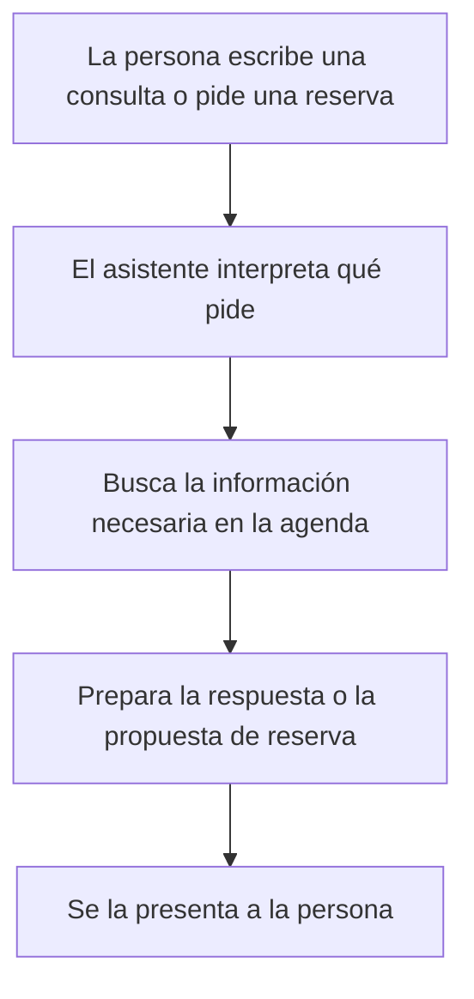

# Clase 10 — Integración: monitoreo y gobernanza de sistemas de IA

**Duración:** 120 minutos  
**Modalidad:** explicación guiada, demostración y taller integrador  
**Producto:** mapa de arquitectura y ficha de monitoreo, revisión humana y trazabilidad  
**Continuidad:** clases 3, 4, 7, 8 y 9 del módulo 5

## Pregunta central

**¿Cómo comprobamos que un sistema de IA sigue siendo útil y que sus decisiones se pueden revisar?**

## Objetivos de aprendizaje

Al finalizar, vas a poder:

- distinguir un cambio en los datos de una caída en el rendimiento;
- proponer un ciclo de monitoreo, diagnóstico y mejora;
- explicar cuándo el sistema busca información y cuándo conserva memoria;
- incluir una intervención humana y un registro de lo ocurrido;
- reconocer en un flujo qué pasos conviene agregar para que el sistema sea comprobable y revisable, y justificarlos.

## Idea central

Un sistema de IA continúa expuesto a cambios después de su puesta en marcha. Para que siga siendo útil, el monitoreo detecta señales, la evaluación con resultados reales mide el rendimiento y la gobernanza define quién investiga, decide y documenta. Para que sea revisable, conviene saber qué información usa, qué recuerda y qué acciones deja para una persona.

Esta clase está pensada para prepararte para el ejercicio final: vas a recorrer el marco conceptual en tres familias (vigilar y comprobar, buscar y recordar, pausar y registrar) y después aplicarlo sobre un flujo concreto.

## Agenda

| Tiempo | Momento | Propósito |
|---:|---|---|
| 0–8 min | Apertura | Recordar qué puede cambiar después del despliegue |
| 8–25 min | Vigilar y comprobar | Distinguir una señal de cambio de una medición de precisión |
| 25–40 min | Ciclo de mejora | Definir investigación y validación antes de actualizar |
| 40–55 min | Buscar, recordar, pausar y registrar | Diferenciar información, memoria, aprobación y trazabilidad |
| 55–70 min | Caso integrador | Presentar el flujo base del centro cultural |
| 70–100 min | Ejercicio grupal | Agregar pasos al flujo y justificarlos |
| 100–112 min | Defensa breve | Justificar pasos y límites |
| 112–120 min | Cierre | Anotar una señal prioritaria |

## 1. Apertura

Pensá en un sistema que funcionaba bien cuando se publicó. Anotá tres cosas que podrían cambiar con el tiempo: una relacionada con los datos, una con el uso de la aplicación y una con las reglas de la organización.

## 2. Vigilar y comprobar

### Cambios en lo que llega

Se habla de **cambio en los datos** cuando las características o la distribución de lo que llega al sistema se parecen menos a los datos con los que se lo probó. Es una señal para investigar; por sí sola no prueba que el sistema ahora cometa más errores. Por ejemplo, en el recorrido de hoy: si cambia la frecuencia con la que se ofrecen ciertas actividades, eso llama la atención pero todavía no dice si las predicciones empeoraron.

### Medir contra resultados reales

Para saber si un sistema que anticipa un número sigue siendo útil, hay que comparar lo que anticipó con lo que efectivamente ocurrió, cuando el resultado real esté disponible. Una variación de la entrada y una variación del error están relacionadas, pero no significan lo mismo.

| Evidencia | Qué permite decir | Qué todavía no permite concluir |
|---|---|---|
| Cambió la frecuencia de una categoría de entrada | La composición de lo que llega es distinta | Que la calidad del sistema necesariamente cayó |
| Aumentó el desvío frente a resultados reales | El rendimiento medido empeoró en el período observado | Qué cambio fue la causa |
| Los desvíos se concentran en un grupo de casos | El promedio general puede ocultar diferencias | Que todas las personas se ven afectadas igual |

Para describir el desvío se puede usar una sola cifra promedio (cuánto se equivoca el sistema en las unidades del resultado) y, si interesa, cuánto pesan los errores grandes. No hay una cifra universalmente mejor: la elección depende de qué tipo de error cuesta más en cada servicio. En este ejercicio no hace falta calcular nada; alcanza con decidir y explicar el tipo de desvío que importa.

## 3. Ciclo de monitoreo y mejora

1. Definir qué datos, resultados y grupos se van a observar.
2. Guardar una referencia para comparar los datos que llegan.
3. Medir el rendimiento cuando se disponga de resultados reales.
4. Investigar los cambios y errores antes de atribuir una causa.
5. Evaluar una posible actualización con datos que no se usaron para ajustarla.
6. Documentar quién aprobó el cambio, cómo se comprobó y cómo se volvería atrás si empeora.
7. Seguir midiendo después de actualizar.

Una alerta no obliga a cambiar el sistema. Primero hay que validar los datos, comprender el problema y decidir si un cambio es necesario.

## 4. Buscar, recordar, pausar y registrar

Un sistema que conversa con personas puede buscar información, recordar lo dicho, detener acciones para una persona y dejar registro. Son funciones distintas, y conviene identificarlas por separado para saber qué pasos agregar al flujo.

### Buscar información (de dónde sale lo confiable)

Cuando hay que responder con datos que deben estar actualizados y autorizados (horarios, condiciones, descripciones), el sistema los recupera de una fuente definida. Que el sistema tenga esa fuente no le da el contexto de la conversación actual.

### Recordar lo dicho en la conversación

Para no perder el hilo, el sistema conserva lo que la persona ya dijo (por ejemplo, un horario preferido). Que el sistema recuerde una preferencia no reemplaza tener los datos vigentes a mano.

### Pausar para que una persona decida

Una acción con impacto (afectar una reserva, la disponibilidad de una sala) conviene detenerla antes de ejecutarla para que alguien la revise. Quien revisa necesita ver qué pidió la persona, qué información se usó y qué se propone hacer.

### Dejar registro de lo ocurrido

Dejar registro de cada paso permite reconstruir más tarde qué ocurrió y quién intervino; ayuda a investigar cuando algo no sale como se esperaba. Un registro aporta evidencia para analizar el funcionamiento; por sí solo no demuestra que la decisión fue correcta.

Ejemplo de un registro para una solicitud de reserva:

```json
{
  "session_id": "SES-204",
  "event": "reserva_propuesta",
  "source_ref": "politica_reservas_v3",
  "tool": "crear_reserva",
  "decision": "reservar sala 2 el jueves a las 16",
  "human_review": "aprobada",
  "result": "reserva registrada"
}
```

El registro debe ser suficiente para revisar el evento sin guardar datos personales innecesarios. La organización define quién accede, cuánto tiempo conserva los registros y cómo corrige errores.

La norma **ISO/IEC 42001:2023** provee un marco de sistema de gestión para la gestión responsable de sistemas de IA. En clase lo conectamos con decisiones concretas: asignar responsables, identificar riesgos, definir controles, observar resultados y revisar si los controles funcionan. Un registro de eventos aporta evidencia para analizar el funcionamiento; por sí solo no demuestra cumplimiento ni que una decisión haya sido correcta.

## 5. Presentación del caso: el centro cultural

### Qué hace el sistema

Un centro cultural quiere estimar la asistencia semanal para organizar recursos y ofrecer un asistente que responda consultas sobre la agenda y prepare solicitudes de reserva.

Entre otras cosas, el sistema puede:

- estimar cuánta gente vendrá a cada actividad;
- responder con los horarios, condiciones y descripciones aprobadas;
- recordar lo que la persona dijo antes en la conversación (por ejemplo, un horario preferido);
- pausar ante una reserva que afecta la disponibilidad para que alguien la confirme;
- dejar registro de los pasos para poder revisar después qué ocurrió.

### El flujo base

El caso parte de un **flujo mínimo**: el camino que sigue el asistente desde que la persona escribe hasta que recibe una respuesta. Este flujo no incluye aún vigilancia, aprobación ni registro; es el esqueleto al que se le pueden agregar pasos.



Por sí solo, este flujo no comprueba que el sistema sigue siendo útil, no detiene decisiones con impacto ni deja rastro de lo ocurrido. Eso es lo que se agrega en el ejercicio.

## 6. Ejercicio grupal

### Consigna

Partiendo del flujo base que se presentó en la sección anterior, **agreguen los pasos que consideren necesarios** para que el sistema del centro sea comprobable y revisable, y **justifiquen cada paso**. No hay una cantidad fija: sumen todos los que crean convenientes, siempre que cada uno se pueda explicar.

### Qué se puede agregar (integra lo trabajado)

Las secciones 2 y 3 preparan la primera familia, y la sección 4 prepara las otras dos:

- **Vigilar y comprobar:** registrar las entradas, definir una señal de que algo cambió y comparar lo que el sistema anticipó con lo que realmente ocurrió. Recordá que una señal de cambio y una medición de precisión son cosas distintas.
- **Buscar y recordar:** indicar de dónde sale la información confiable y qué dato de la conversación se conserva. Son funciones distintas.
- **Pausar y registrar:** detener la acción que tiene impacto para que una persona la decida y dejar registro de cada paso, para poder reconstruir qué ocurrió y quién intervino.

### Cómo resolverlo

1. Lean el flujo base y marquen el punto donde conviene insertar cada paso nuevo.
2. Para cada paso agregado, completen la tabla siguiente.
3. Reconstruyan el **flujo completo** en un diagrama Mermaid que incluya los pasos del flujo base y los que agregaron.
4. Justifiquen cada paso: qué problema del flujo base resuelve y qué evidencia produce.

### Entrega del equipo

Cuando terminen, entreguen:

1. **Un diagrama Mermaid** con el flujo completo (base + pasos agregados).
2. **La tabla de pasos justificados**, con una fila por cada paso nuevo.

La primera fila de la tabla es un ejemplo orientativo (del centro cultural); ajústenla o reemplácenla.

| Paso agregado | Qué hace | Dónde se inserta | Qué evidencia produce | Quién interviene | Justificación |
|---|---|---|---|---|---|
| **Ejemplo: registrar la reserva** | Guarda quién pidió, qué se propuso y cómo terminó | Después de que la persona pide la reserva, antes de confirmarla | Reconstruir después qué ocurrió y quién intervino | Responsable de reservas | Sin registro no se puede revisar un problema posterior |
|  |  |  |  |  |  |
|  |  |  |  |  |  |

## 7. Defensa breve

Cada equipo presenta un paso agregado y un límite de su análisis. El grupo revisa si:

- el paso está bien ubicado en el flujo;
- la justificación explica qué problema resuelve y qué evidencia produce;
- la señal de cambio se distingue de la comprobación de precisión;
- la búsqueda de información y lo recordado de la conversación quedan como funciones distintas;
- la acción con impacto se pausa para una persona y deja registro;
- el registro permite saber qué ocurrió y quién intervino.

## 8. Cierre

Completá: **“Si observo ___, primero buscaría ___ antes de recomendar un cambio.”**

## Criterio de logro

La propuesta incorpora pasos para comprobar el funcionamiento, distingue señales de rendimiento, asigna responsabilidades, conserva una revisión humana donde corresponde y documenta qué evidencia falta.

## Referencias

- [ISO/IEC 42001:2023 — página oficial de la norma](https://www.iso.org/es/norma/42001)
- [ISO — explicación institucional de los sistemas de gestión de IA](https://www.iso.org/insights/iso-42001-explained)
